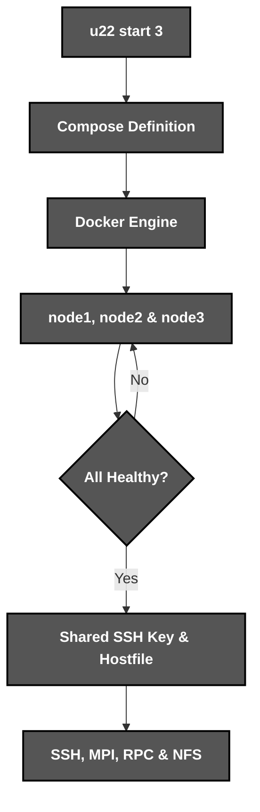
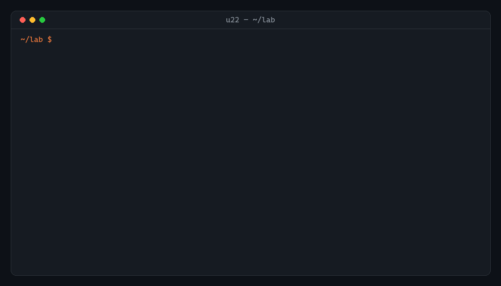

<div align="center">



*A local **Ubuntu cluster** in a single **command***

</div>

# 📝 **Description**

<div align="center">

***u22 cluster*** is a **command-line tool** that starts Ubuntu containers which reach each other over ***SSH*** by name, with ***MPI***, ***RPC*** and ***NFS*** ready for distributed systems work
</div>
<br>
<div align="right">

***It was born as a fourth-year university project*** 🎓

</div>

# 🛠️ **u22 cluster Architecture & Workflow**

<div align="center">


</div>

# 📁 **Project Structure**

```
u22-cluster/
├── .gitattributes                                      # Git Attributes Configuration
├── .gitignore                                          # Git Ignore Rules
├── LICENSE                                             # Project License
├── pyproject.toml                                      # Package & Tool Configuration
├── README.md                                           # You are here! ⬅️
│
├── .github/workflows/
│   └── ci.yml                                          # Lint, Unit & Live Cluster Tests
│
├── assets/                                             # Visual Assets
│   ├── demo.gif                                        # Real Cluster Session
│   └── logo.svg                                        # u22 cluster Logo
│
├── examples/
│   └── hello.c                                         # MPI Hello World
│
├── src/u22_cluster/
│   ├── cli.py                                          # Command-Line Interface
│   ├── cluster.py                                      # Start, Run, MPI & Stop
│   ├── compose.py                                      # Compose Definition
│   ├── docker.py                                       # Docker Command Runner
│   └── image/
│       ├── Dockerfile                                  # Ubuntu Node Image
│       └── entrypoint.sh                               # Keys, Hostfile, RPC, NFS & SSH
│
└── tests/                                              # Unit & Live Cluster Tests
```

# 🔧 **Installation**

## 📋 Requirements

- **Python 3.10+**
- **Docker**

## ⚙️ Quick Setup

1. **Clone the repository**
   ```bash
   git clone https://github.com/cristiangilsanz/u22-cluster.git
   cd u22-cluster
   ```

2. **Create a virtual environment** *(recommended)*
   ```bash
   python -m venv .venv
   source .venv/bin/activate      # Windows: .venv\Scripts\activate
   ```

3. **Install u22 cluster**
   ```bash
   pip install -e .
   ```

<br>

# 🚀 **See *u22 cluster* in Action**

## 🖥️ To Start a Cluster:

1. **Start three nodes from the folder you want to share:**

```bash
u22 start 3
```

2. **Your folder appears as /work on every node, and the first start builds the node image**

## 🧪 To Run the Tests:

1. **Install the development tools:**

```bash
pip install -e ".[dev]"
```

2. **Run the tests and the linter:**

```bash
pytest
ruff check .
```

3. **Start real clusters to test them end to end** *(needs Docker)*:

```bash
U22_LIVE=1 pytest tests/test_live.py
```

# 🎬 **Live Session**

<div align="center">
    
</div>

<br>

## ⌨️ Commands

<div align="center">

| Command | Action | Description |
|:---:|---|---|
| `u22 start <nodes>` | Start Cluster | Starts the nodes and waits until they are ready |
| `u22 status` | Show Status | Lists the nodes with their state and address |
| `u22 shell <node>` | Open Shell | Opens a shell on a node |
| `u22 run <node> -- <command>` | Run Command | Runs a command on one node or on all of them |
| `u22 mpirun -n <processes> <program>` | Run MPI Program | Launches an MPI program across the nodes |
| `u22 stop` | Stop Cluster | Stops and removes the nodes |
| `u22 destroy` | Destroy Cluster | Removes the nodes, their shared data and the images |
| `u22 build` | Build Image | Builds the node image ahead of time |

</div>

## ⚙️ Options

<div align="center">

| Option | Used With | Description |
|:---:|---|---|
| `--ubuntu 24.04` | Start, Build | Picks the Ubuntu release of the nodes |
| `--nfs` | Start | Runs an NFS server that exports /export on every node |
| `--work <folder>` | Start | Shares another folder as /work |
| `--project <name>` | Every Command | Runs several clusters side by side |

</div>

# 💡 **Tips for Best Results**

The following tips help you get the most out of ***u22 cluster***:

> - Run ***u22 run all -- hostname -I*** to see every node at once.
> - Compile once with ***mpicc*** and launch with ***u22 mpirun***.
> - Add ***--nfs*** to practise network file systems between nodes.

# 📚 **Tech Stack & Other Resources**

## 📦 Tech Stack

### 🧩 **Programming Languages**
- [Python](https://docs.python.org/3/)
- [Bash](https://www.gnu.org/software/bash/manual/)

### 🐳 **Containers**
- [Docker Engine](https://docs.docker.com/engine/)
- [Docker Compose](https://docs.docker.com/compose/)

### 🌐 **Distributed Systems**
- [OpenSSH](https://www.openssh.com/manual.html)
- [MPICH](https://www.mpich.org/documentation/guides/)
- [ONC RPC](https://datatracker.ietf.org/doc/html/rfc5531)
- [NFS](https://help.ubuntu.com/community/NFSv4Howto)

### 🧪 **Testing**
- [Pytest](https://docs.pytest.org/)

### 🧹 **Code Quality**
- [Ruff](https://docs.astral.sh/ruff/)
- [ShellCheck](https://www.shellcheck.net/)

### ⚙️ **Continuous Integration**
- [GitHub Actions](https://docs.github.com/actions)

# 🙏 **Credits & Thanks**

This project was created on my own in my fourth year of university 🤝.

Thanks to the *MPICH* and *Docker* teams for the tools every node is built on ✨.

# 📄 **License**

This project is licensed under the MIT License - see the [LICENSE](LICENSE) file for details.

# 📞 **Get Help & Connect**

- 🐛 [Open an issue](https://github.com/cristiangilsanz/u22-cluster/issues)
- 📧 cristiangilsanz@gmail.com

<div align="center">
  <br>

  **Made with 💖 for the Distributed Systems Community**

  [⭐ Star this repo](https://github.com/cristiangilsanz/u22-cluster) | [🍴 Fork it](https://github.com/cristiangilsanz/u22-cluster/fork)

  <br>

  <a href="https://www.buymeacoffee.com/cristiangilsanz" target="_blank">
    
  </a>

</div>
